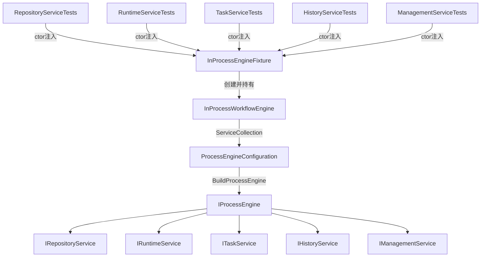

## 用户需求

为 `NActiviti/Sys.Bpm.Engine` 项目创建独立的集成测试项目，针对引擎核心服务（RepositoryService、RuntimeService、TaskService、HistoryService、ManagementService）进行进程内（In-Process）集成测试。

## 产品概述

新建测试项目 `Tests/Sys.Bpm.Engine.Tests`，采用与现有 `Sys.Bpm.Client.Tests` 一致的进程内引擎启动模式（`InProcessWorkflowEngine` + `StandaloneProcessEngineConfiguration`），不依赖数据库和 REST 层，直接通过命令执行器（`ICommandExecutor`）操作 `IProcessEngine`，验证引擎核心功能。

## 核心功能

- **测试基础设施**：复用 `InProcessWorkflowEngine` 启动引擎，提供统一的测试夹具（Fixture），支持通过 `ProcessEngineFactory.CreateProcessEngine(name)` 获取引擎实例
- **RepositoryService 测试**：流程定义部署、查询最新版本、重复部署过滤验证
- **RuntimeService 测试**：启动流程实例、流程变量读写、流程实例终止
- **TaskService 测试**：任务查询（按实例ID/按办理人）、任务认领、任务完成、会签任务流转
- **HistoryService 测试**：历史流程实例查询、历史任务实例查询、历史变量查询
- **ManagementService 测试**：作业查询、流程定义挂起与激活
- **配置与资源**：复用已有 `.bpmn` 样例文件（从 `Sys.Bpm.Client.Tests/resources/samples/` 拷贝常用测试流程），提供 `appsettings.json` 和 `activiti.cfg.json`

## 技术栈

- 目标框架：`net6.0`（与被测项目一致）
- 测试框架：`xunit 2.9.3` + `Xunit.Extensions.Ordering 1.4.5`（与现有测试项目完全一致）
- 测试宿主：`Microsoft.AspNetCore.TestHost 6.0.36`（保持与现有项目一致）
- Mock 框架：`Moq 4.14.4`（用于外部代理桩注入）
- 日志：`Serilog 2.11.0` + `Serilog.Extensions.Logging.File 2.0.0`
- 数据库驱动：`Microsoft.Data.SqlClient 5.0.0`
- 项目引用：`Sys.Bpm.Engine`（直接引用，无需 Rest 层）

## 实现方案

### 核心策略

采用进程内（In-Process）集成测试模式，直接通过 `IProcessEngine` API 驱动引擎，无需启动 HTTP 服务。整体复用 `Sys.Bpm.Client.Tests` 中 `InProcessWorkflowEngine` 的启动模式，但去掉 REST 层依赖，测试项目仅引用 `Sys.Bpm.Engine`。

**引擎初始化流程：**

1. `InProcessEngineFixture`（ICollectionFixture）持有单一 `IProcessEngine` 实例
2. 通过 `ServiceCollection.AddProcessEngine(config)` + `app.UseProcessEngine(lifetime)` 完成完整 DI 初始化
3. 每个测试类通过构造注入获得 `IProcessEngine` 和 `ICommandExecutor`
4. 通过 `Authentication.AuthenticatedUser` 注入测试用户身份

### 关键设计决策

- **共享 Fixture（`InProcessEngineFixture`）**：通过 `[Collection]` + `ICollectionFixture<T>` 实现全测试集共享一个引擎实例，避免重复初始化耗时，与现有 `IntegrationTestContext.CreateDefaultUnitTestContext()` 的单例模式保持一致
- **测试隔离**：每个测试用例使用随机 GUID 作为 TenantId 前缀和用户 ID，流程名称带时间戳，避免用例间数据污染
- **禁用并行化**：`[assembly: CollectionBehavior(DisableTestParallelization = true)]`，与现有 `AssemblyInfo.cs` 模式一致，防止引擎共享状态竞争

### 性能注意事项

- 引擎启动代价高，使用 `ICollectionFixture` 确保整个测试集只初始化一次
- `DatabaseSchemaUpdate = "false"` 避免每次运行 Schema 检查

## 实现说明

- 直接复用现有 `InProcessWorkflowEngine.Create()` 的初始化逻辑，但新 Fixture 类不引用 REST 层，去掉 `IServiceWebApiHttpProxy` 替换逻辑（或 Mock 掉）
- 复用 `IntegrationTestContext.ReadBpmn(name)` 静态方法读取 `.bpmn` 文件
- `Authentication.AuthenticatedUser` 在每个测试方法入口处通过 `InProcessWorkflowEngine.TestUser` 设置，参照 `BoundaryEventTest` 模式
- 通过 `ICommandExecutor commandExecutor = (processEngine.ProcessEngineConfiguration as ProcessEngineConfigurationImpl).CommandExecutor` 获取命令执行器，参照现有 `InProcessTest` / `BoundaryEventTest` 完全一致的模式
- 配置文件（`appsettings.json` / `resources/activiti.cfg.json`）内容与 `Sys.Bpm.Client.Tests` 完全一致，`databaseSchemaUpdate` 保持 `"false"`
- 解决方案文件 `NActiviti.sln` 需添加新测试项目节点，放入 Tests 解决方案文件夹

## 架构设计



## 目录结构

```
Tests/Sys.Bpm.Engine.Tests/                              # [NEW] 引擎集成测试项目根目录
├── Sys.Bpm.Engine.Tests.csproj                          # [NEW] 项目文件：net6.0，xunit/Moq/TestHost依赖，仅引用Sys.Bpm.Engine
├── AssemblyInfo.cs                                      # [NEW] 禁用并行化、TestCaseOrderer/CollectionOrderer，与Sys.Bpm.Client.Tests完全一致
├── xunit.runner.json                                    # [NEW] {"shadowCopy": false}，与现有一致
├── appsettings.json                                     # [NEW] 数据库连接串（SqlServer）、WorkflowDataSource配置，与Sys.Bpm.Client.Tests一致
├── Fixtures/
│   └── InProcessEngineFixture.cs                       # [NEW] ICollectionFixture实现：封装InProcessWorkflowEngine.Create()初始化，提供ProcessEngine/CommandExecutor访问属性，实现IDisposable关闭引擎
├── resources/
│   └── activiti.cfg.json                               # [NEW] 引擎参数配置（asyncExecutorActivate:false, databaseSchemaUpdate:"false", history:"audit"），与Sys.Bpm.Client.Tests完全一致
│   └── samples/
│       ├── 简单顺序流.bpmn                              # [NEW] 复制自Sys.Bpm.Client.Tests，用于基础流程测试
│       ├── 分支合并.bpmn                                # [NEW] 复制自Sys.Bpm.Client.Tests，用于并行网关测试
│       ├── 指定节点启动.bpmn                            # [NEW] 复制自Sys.Bpm.Client.Tests，用于指定活动启动测试
│       └── 会签流程.bpmn                                # [NEW] 复制自Sys.Bpm.Client.Tests，用于会签（多实例）测试
├── Tests/
│   ├── RepositoryServiceTests.cs                        # [NEW] 测试IRepositoryService：Deploy部署、CreateProcessDefinitionQuery查询最新版本、EnableDuplicateFiltering过滤重复部署、GetDeploymentResourceNames资源列表，使用DeployCmd+CommandExecutor直接调用
│   ├── RuntimeServiceTests.cs                           # [NEW] 测试IRuntimeService：StartProcessInstance(by definitionId/businessKey)、GetVariables/SetVariable、DeleteProcessInstance终止流程，验证流程状态和变量正确性
│   ├── TaskServiceTests.cs                              # [NEW] 测试ITaskService：CreateTaskQuery查询任务列表、GetMyTasks按用户查询、ClaimTask认领、CompleteTask完成、会签任务多人流转，验证任务状态流转
│   ├── HistoryServiceTests.cs                           # [NEW] 测试IHistoryService：CreateHistoricProcessInstanceQuery历史实例查询（已完成/已删除）、CreateHistoricTaskInstanceQuery历史任务查询、CreateHistoricVariableInstanceQuery历史变量查询
│   └── ManagementServiceTests.cs                        # [NEW] 测试IManagementService：CreateJobQuery作业查询、SuspendProcessDefinitionById挂起流程定义、ActivateProcessDefinitionById激活，验证状态变更
```

## Agent Extensions

### SubAgent

- **code-explorer**
- 用途：在生成测试代码时，若需要查找更多 BPMN 样本文件内容或确认特定 API 使用方式，使用该子代理批量搜索相关文件
- 预期结果：精准定位可复用的 BPMN 文件路径及现有命令类（DeployCmd、StartProcessInstanceCmd、CompleteTaskCmd 等）的构造方式�
